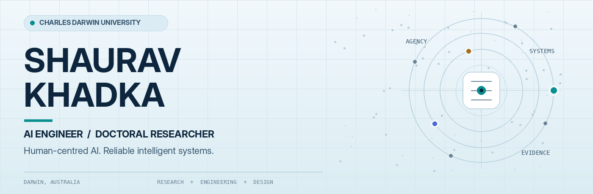
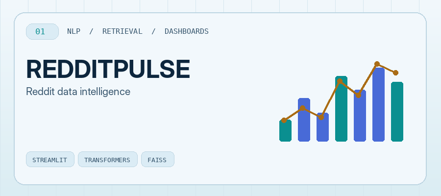
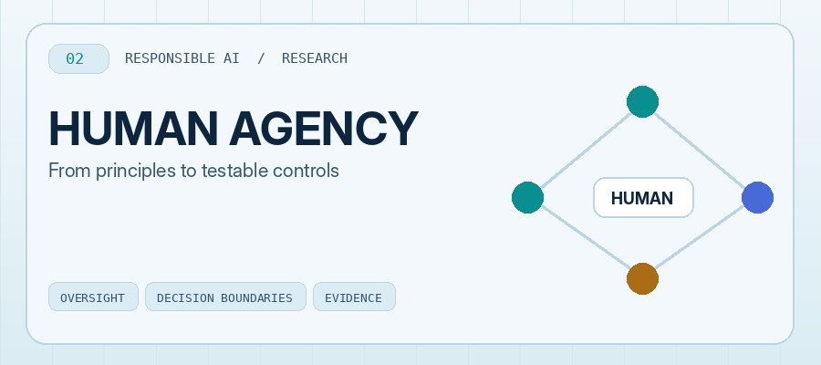
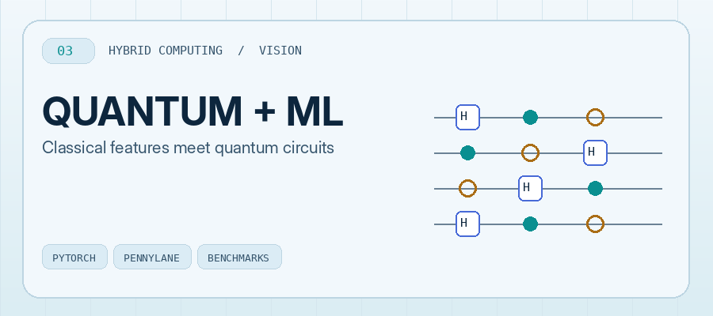
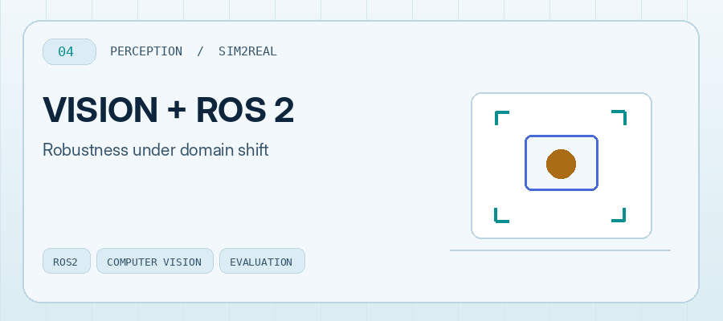
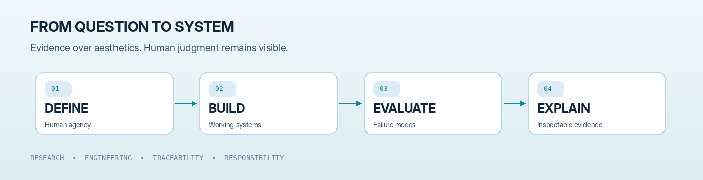

<picture>
  <source media="(max-width: 680px) and (prefers-color-scheme: dark)" srcset="assets/hero-mobile-dark.png">
  <source media="(max-width: 680px) and (prefers-color-scheme: light)" srcset="assets/hero-mobile-light.png">
  <source media="(prefers-color-scheme: dark)" srcset="assets/hero-dark.png">
  <source media="(prefers-color-scheme: light)" srcset="assets/hero-light.png">
  
</picture>

**AI Engineer · Doctoral Researcher at Charles Darwin University**

*I build intelligent systems and study how people can remain informed, capable and accountable when AI enters real decisions.*

[Selected work](#-selected-work) · [Research](#-research--publications) · [Technical stack](#-technical-stack) · [Approach](#-engineering-approach) · [Connect](#-connect)

---

## ✦ In Focus

I work where **applied AI engineering** meets **human-centred system design**. My current PhD research at **Charles Darwin University (Darwin, Australia)** examines meaningful human judgment, oversight, and standards-aligned controls in generative-AI workflows, with teacher education as the initial research setting.

<table>
<tr>
<td width="50%" valign="top">

### 🔬 Research lens
**Human agency · Responsible GenAI · Socio-technical evaluation**

What information, authority, and practical opportunity must a person retain when an AI system supports consequential decisions?

</td>
<td width="50%" valign="top">

### ⚙️ Engineering lens
**Document AI · NLP / Retrieval · Vision · Evaluation**

I build experiments and systems with attention to baselines, failure modes, traceability, reliability and usable interfaces.

</td>
</tr>
</table>

## 🚀 Selected Work

<table>
<tr>
<td width="50%" valign="top">
  <a href="https://github.com/shauravkhadka/RedditPulse"><picture>
  <source media="(prefers-color-scheme: dark)" srcset="assets/redditpulse-dark.png">
  <source media="(prefers-color-scheme: light)" srcset="assets/redditpulse-light.png">
  
</picture></a>
  <h3><a href="https://github.com/shauravkhadka/RedditPulse">RedditPulse</a></h3>
  
A Streamlit research dashboard integrating sentiment analysis, topic discovery and semantic retrieval across Reddit discussions.

  
<a href="https://github.com/shauravkhadka/RedditPulse"><b>Code ↗</b></a> · <a href="https://redditpulse.streamlit.app"><b>Demo ↗</b></a>

</td>
<td width="50%" valign="top">
  <a href="https://shauravkhadka.com.np/work/responsible-ai-governance/"><picture>
  <source media="(prefers-color-scheme: dark)" srcset="assets/governance-dark.png">
  <source media="(prefers-color-scheme: light)" srcset="assets/governance-light.png">
  
</picture></a>
  <h3><a href="https://shauravkhadka.com.np/work/responsible-ai-governance/">Human Agency &amp; Responsible AI</a></h3>
  
My current doctoral research: translating responsible-AI principles into decision boundaries, governance controls and testable evidence. <em>Research in progress, not completed findings.</em>

  
<a href="https://shauravkhadka.com.np/work/responsible-ai-governance/"><b>Research scope ↗</b></a>

</td>
</tr>
<tr>
<td width="50%" valign="top">
  <a href="https://github.com/shauravkhadka/Hybrid-Quantum-Classical-Image-Classifier-"><picture>
  <source media="(prefers-color-scheme: dark)" srcset="assets/quantum-dark.png">
  <source media="(prefers-color-scheme: light)" srcset="assets/quantum-light.png">
  
</picture></a>
  <h3><a href="https://github.com/shauravkhadka/Hybrid-Quantum-Classical-Image-Classifier-">Hybrid Quantum–Classical Classifier</a></h3>
  
An experimental CNN-to-variational-quantum-circuit pipeline using PyTorch and PennyLane, with a classical baseline for comparison.

  
<a href="https://github.com/shauravkhadka/Hybrid-Quantum-Classical-Image-Classifier-"><b>Code &amp; experiment ↗</b></a>

</td>
<td width="50%" valign="top">
  <a href="https://shauravkhadka.com.np/work/vision-ros2-sim2real/"><picture>
  <source media="(prefers-color-scheme: dark)" srcset="assets/robotics-dark.png">
  <source media="(prefers-color-scheme: light)" srcset="assets/robotics-light.png">
  
</picture></a>
  <h3><a href="https://shauravkhadka.com.np/work/vision-ros2-sim2real/">Vision, ROS 2 &amp; Sim2Real</a></h3>
  
Collaborative robotics work investigating model failure on robot-camera images and performance recovery after deployment-specific adaptation.

  
<a href="https://shauravkhadka.com.np/work/vision-ros2-sim2real/"><b>Case study ↗</b></a> · <a href="https://github.com/shauravkhadka/Pasta-Detection-Robot-"><b>ROS 2 project ↗</b></a>

</td>
</tr>
</table>

<strong>Additional experiments, open resources &amp; systems ↗</strong>

- [Nepali NLP Resources](https://github.com/shauravkhadka/nepali-nlp-resources) — curated multilingual and low-resource NLP reference index.
- [Non-Markovian ML trajectories](https://github.com/shauravkhadka/qnl_nonmarkov_ml) — quantum dynamics research-code experiments.
- [Reinforcement-Learning Benchmark Suite](https://shauravkhadka.com.np/work/reinforcement-learning-benchmark-suite/) — documented training and evaluation comparisons.
- [Production AI Reliability](https://shauravkhadka.com.np/) — documented evaluation approach for document-intelligence pipelines; confidential work is not published as source code.
- [All public repositories](https://github.com/shauravkhadka?tab=repositories) — explore the wider collection.

## 🛠 Technical Stack

**Core languages, research and ML**

**Tools used across projects**

## 🧭 Engineering Approach

<picture>
  <source media="(max-width: 680px) and (prefers-color-scheme: dark)" srcset="assets/system-mobile-dark.png">
  <source media="(max-width: 680px) and (prefers-color-scheme: light)" srcset="assets/system-mobile-light.png">
  <source media="(prefers-color-scheme: dark)" srcset="assets/system-dark.png">
  <source media="(prefers-color-scheme: light)" srcset="assets/system-light.png">
  
</picture>

The recurring principle across my work: **a system is only as trustworthy as the evidence around its decisions.** Model outputs matter, but so do inputs, failure analysis, review boundaries, and what happens in deployment.

## 📚 Research &amp; Publications

I maintain public technical reports and preprints alongside my doctoral research. **The records below are non-peer-reviewed technical outputs**, not journal papers.

| Selected technical output | Record |
| --- | --- |
| **FieldTrace-OCR:** reliability-oriented evaluation for invoice-parsing pipelines | [DOI ↗](https://doi.org/10.5281/zenodo.20669709) |
| **A Lightweight Multilingual Semantic Search Pipeline** | [DOI ↗](https://doi.org/10.5281/zenodo.20652874) |
| **Temporal Context and Momentum-Aware Reward Shaping in Reinforcement Learning** | [DOI ↗](https://doi.org/10.5281/zenodo.20669675) |
| **A Retrieval-Augmented Financial Advisory Prototype with Evidence-Gated Response Generation** | [DOI ↗](https://doi.org/10.5281/zenodo.20652567) |

[ORCID research record ↗](https://orcid.org/0009-0009-9874-8239) · [Research programme ↗](https://shauravkhadka.com.np/work/responsible-ai-governance/) · [Books &amp; writing ↗](https://shauravkhadka.com.np/)

<strong>Background, wider interests &amp; selected learning</strong>

- **Education:** PhD, Charles Darwin University (in progress); Master of Information Technology (Artificial Intelligence), Macquarie University; BSc (Hons) Computing, First Class Honours.
- **Experience:** AI/ML R&amp;D at Truuth; earlier technology leadership as CTO at Picpoint Nepal.
- **Selected learning:** Harvard CS50x, AI governance, design thinking and sustainability leadership.
- **Beyond a single discipline:** machine learning, human-computer interaction, robotics, technology leadership, digital well-being and nonfiction writing.

For a fuller and more current professional record, see my [portfolio](https://shauravkhadka.com.np/).

---

## 🤝 Connect

**Research collaboration · AI engineering · Intelligent systems**

[Portfolio](https://shauravkhadka.com.np/) · [LinkedIn](https://www.linkedin.com/in/shauravkhadka/) · [ORCID](https://orcid.org/0009-0009-9874-8239) · [More projects](https://github.com/shauravkhadka?tab=repositories)

Build what can be inspected. Measure before claiming. Keep human judgment explicit.

